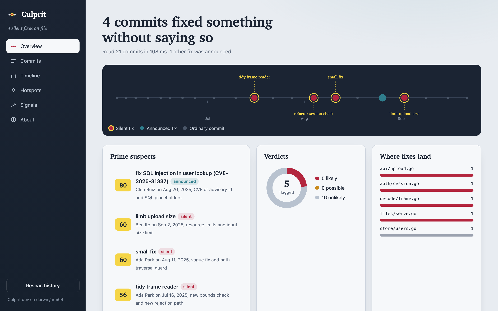
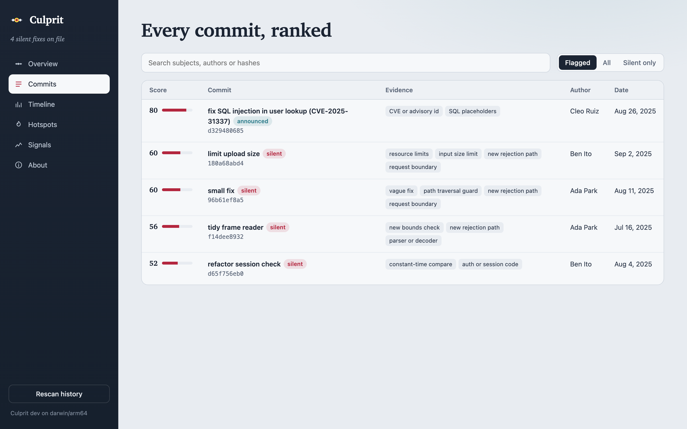
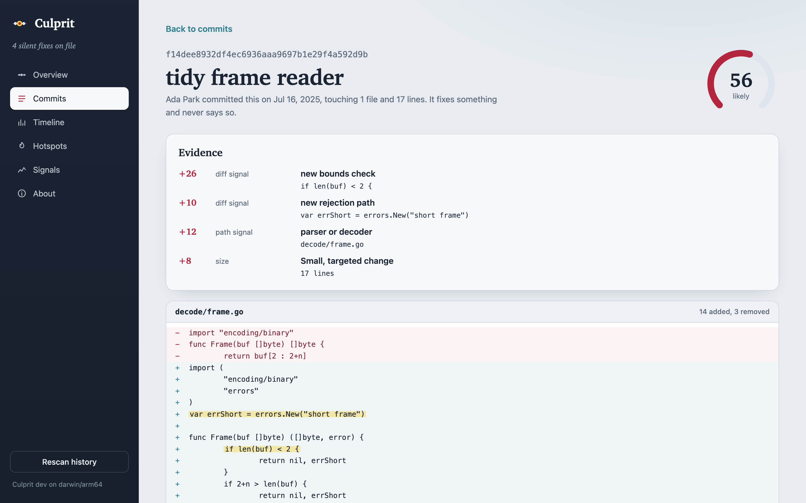
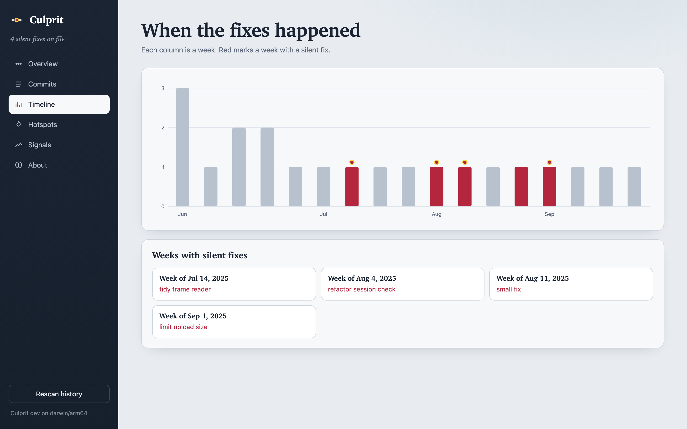
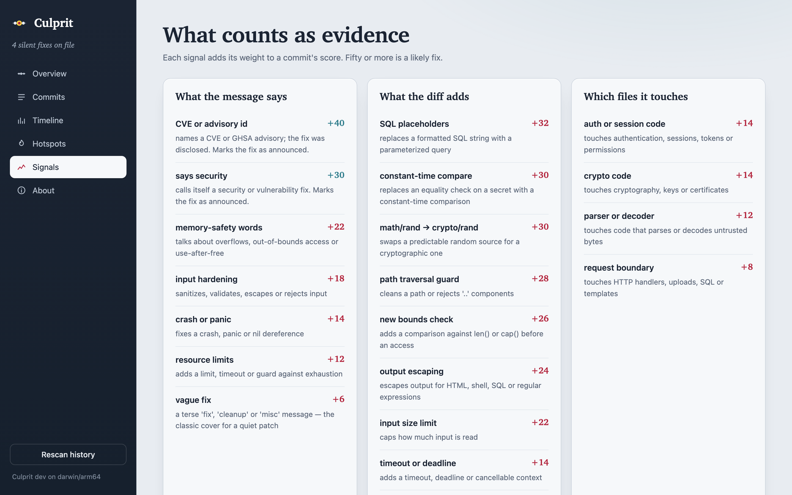

<picture>
  <source media="(prefers-color-scheme: dark)" srcset="docs/assets/wordmark-dark.svg">
  
</picture>

[](https://github.com/cansarihan/culprit/actions/workflows/ci.yml)
[](https://github.com/cansarihan/culprit/actions/workflows/codeql.yml)
[](https://goreportcard.com/report/github.com/cansarihan/culprit)
[](go.mod)
[](LICENSE)

Projects fix security bugs all the time without saying so. The commit is called
"tidy frame reader" or "small fix", and the vulnerability it closes was live in
every release before it. Culprit reads a repository's history and points at
those commits.

It scores every commit on three kinds of evidence — what the message says, what
the diff adds, and which files it touches — and marks the likely fixes that
never mentioned a CVE or the word security as **silent**. One binary, no
dependencies outside the standard library; it needs only `git`.



## On the command line

```console
$ culprit scan ./relay
./relay
21 commits · 5 likely · 0 possible · 4 silent fixes

SCORE  BAND    KIND       COMMIT    DATE        SUBJECT                                     EVIDENCE
80     likely  announced  d3294806  2025-08-26  fix SQL injection in user lookup (CVE-2…    CVE or advisory id, SQL placeholders
60     likely  silent     180a68ab  2025-09-02  limit upload size                           resource limits, input size limit, new rejection path, request boundary
60     likely  silent     96b61ef8  2025-08-11  small fix                                   vague fix, path traversal guard, new rejection path, request boundary
56     likely  silent     f14dee89  2025-07-16  tidy frame reader                           new bounds check, new rejection path, parser or decoder
52     likely  silent     d65f756e  2025-08-04  refactor session check                      constant-time compare, auth or session code
```

`culprit show` explains one verdict line by line:

```console
$ culprit show ./relay 180a68ab
180a68ab  limit upload size
Ben Ito · 2025-09-02

score 60 · likely · silent fix · 1 file(s), 5 line(s)

  +12  message  resource limits            limit
  +22  diff     input size limit           r.Body = http.MaxBytesReader(w, r.Body, maxUpload)  (api/upload.go)
  +10  diff     new rejection path         http.Error(w, err.Error(), http.StatusRequestEntityTooLarge)  (api/upload.go)
  +8   path     request boundary           api/upload.go
```

## The panel

`culprit serve` opens the repository as a case file. The overview lines every
commit up on one rail and rings the silent fixes; the ledger ranks them; each
commit opens with its score, the evidence behind it, and the diff with the
evidence lines highlighted.

| | |
|---|---|
|  |  |
|  |  |

## What counts as evidence

| Family | Examples | Weight |
|---|---|---|
| Message | names a CVE or GHSA id (marks the fix as announced), memory-safety words, "sanitize", "reject malformed", a bare "fix" | 6 to 40 |
| Diff | a new bounds check, `filepath.Clean` or a `..` guard, `subtle.ConstantTimeCompare`, `http.MaxBytesReader`, output escaping, a string SQL query turned into placeholders, `math/rand` swapped for `crypto/rand`, a new error return | 10 to 32 |
| Path | auth and session code, crypto, parsers and decoders, request handlers | 8 to 14 |

Path evidence only counts alongside message or diff evidence. Files a commit
created are ignored — new code is full of guards that were never missing — and
a small, targeted change earns a bonus. Fifty points is a likely fix; 25 is
possible. `culprit signals` prints the full catalogue.

## Commands

```console
$ culprit scan [repo]                 # rank the history
    -since <when>    only commits newer than this ("6 months ago", 2025-01-01)
    -n <count>       only the most recent commits
    -rev <rev>       walk from this revision instead of HEAD
    -all             list unflagged commits too
    -json | -md      JSON, or a Markdown digest for an issue or review
$ culprit show <repo> <commit>        # explain one commit's verdict
$ culprit signals                     # print the evidence catalogue
$ culprit demo <dir>                  # write the demo history
$ culprit serve -repo <repo>          # host the panel and API
$ culprit version
```

## HTTP API

```console
GET /api/v1/status              build info and the repository being read
GET /api/v1/report[?refresh=1]  the cached scan, or a fresh one
GET /api/v1/commits/{hash}      one commit's verdict and diff
GET /api/v1/signals             the evidence catalogue
```

## Run the demo

The demo builds a 21-commit repository that hides four silent fixes and one
announced one among ordinary work, then serves the panel over it.

```sh
make demo          # panel at http://127.0.0.1:18190
make demo-down
make run           # the same without Docker
```

## How it works

See [docs/architecture.md](docs/architecture.md). In short: `git log` lists the
commits, `git show --unified=0` gives each diff without context lines, the
signals are matched against the message, the added and removed lines and the
paths, and the scan rolls the verdicts up into a ranking, a weekly timeline and
file hotspots. Culprit never checks out or runs the code it reads.

The score is a reading order, not a verdict: start at the top and read the diffs.

## Build

```sh
make build         # ./bin/culprit
make test          # needs git on the path
make lint
```

## License

MIT. See [LICENSE](LICENSE).
