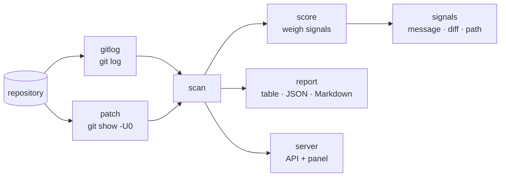

# Architecture

Culprit is a pipeline over a repository's history: list the commits, read each
diff, weigh the evidence, and roll the verdicts up into the views a person reads.
Git does the reading; Culprit never checks out or runs the code.

## Why "silent" matters

A fix that names its CVE is already in every advisory database. The interesting
commit is the one titled "tidy frame reader" that adds a length check to a
parser: the bug it closes shipped in every earlier release, and nothing tells
users to upgrade. Culprit scores how much a commit looks like a security fix,
and separately marks whether it said so.

## Packages

- `internal/gitlog` runs `git log --no-merges` with a field- and
  record-separated format and parses it into commits.
- `internal/patch` runs `git show --unified=0` for one commit and splits the
  diff per file into added and removed lines, marking files the commit created.
- `internal/signals` holds the evidence catalogue in three families. Message
  signals are regular expressions over the subject and body; diff signals look
  at added lines, or at a removed line paired with a safer added one (string SQL
  becoming a placeholder query, `math/rand` becoming `crypto/rand`); path
  signals look at which areas of the tree changed.
- `internal/score` adds up the weights a commit trips and places it in a band.
  Path evidence only counts when message or diff evidence is present, and a
  small change earns a bonus because security fixes tend to be surgical.
- `internal/scan` reads diffs concurrently, scores every commit, and builds the
  ranked list, a Monday-based weekly timeline, file hotspots and per-author
  counts.
- `internal/report` renders a scan as a table, JSON or a Markdown digest.
- `internal/server` caches one scan per repository behind a small API and
  serves the panel. Commit lookups accept only hexadecimal hashes, so a request
  can never smuggle an option into a git command line.
- `internal/demo` writes a repository whose history hides four silent fixes and
  one announced fix among ordinary work. The tests and the demo stack both use it.

## Scoring, briefly

| Band | Score | Reading |
|---|---|---|
| likely | 50 and up | two independent strong signals agree |
| possible | 25 to 49 | one clear signal |
| unlikely | below 25 | nothing worth reading first |

The numbers are a reading order. A high score means "read this diff early", not
"this was a vulnerability".

## Limits

Culprit sees text. It does not parse code, so a bounds check is recognized by
its shape, not its meaning, and a refactor that happens to add one will score.
Files a commit created are ignored on purpose: new code is full of guards that
were never missing. Merge commits are skipped because their diff repeats work
already scored on the branch.
